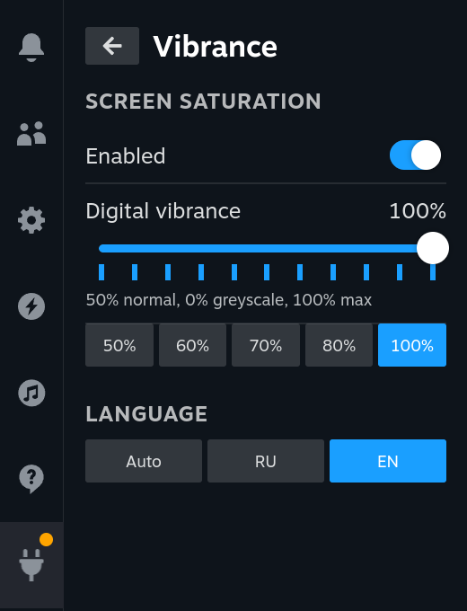

# Vibrance

**Digital vibrance for Steam Deck** - like *Digital Vibrance* in the NVIDIA Control Panel.
Makes colours richer in games and in the Steam UI with one slider.



[Русская версия ниже](#vibrance-ru)

## Features

- Slider 0-100% on the NVIDIA scale: **50% = unchanged**, 0% = greyscale, 100% = twice as saturated
- Quick presets: 50 / 60 / 70 / 80 / 100%
- Greys, white and black are never changed - only saturation, hue stays the same
- Works everywhere: games, Steam UI, video
- The setting is remembered and restored after reboot or Steam restart
- Disabling or uninstalling the plugin restores normal colours
- English / Russian interface (auto or manual)

## How it works

Vibrance generates a 3D LUT (`.cube`) that boosts saturation in gamma 2.2 space and loads it with
`gamescopectl set_look` - the same gamescope "looks" mechanism Valve uses for the built-in
greyscale and colour-blind filters. No system files are modified, nothing is downloaded.

Unlike plugins that change `GAMESCOPE_COLOR_SDR_GAMUT_WIDENESS`, the effect is not limited by
the panel's native gamut, so it can go further.

## Notes

- Tested on Steam Deck OLED, SteamOS 3.8.
- The Steam built-in colour filter (Accessibility) uses the same mechanism: if you turn it on,
  it replaces Vibrance until you change the Vibrance setting again.
- HDR games are not affected (the look is applied to SDR output only).

## Build

```bash
pnpm i
pnpm run build
```

## License

MIT

---

<a id="vibrance-ru"></a>
# Vibrance (RU)

**Цифровая яркость для Steam Deck**, как *Digital Vibrance* в панели NVIDIA.
Делает цвета сочнее в играх и в интерфейсе Steam одним ползунком.

## Возможности

- Ползунок 0-100% по шкале NVIDIA: **50% - как было**, 0% - ч/б, 100% - вдвое насыщеннее
- Быстрые варианты: 50 / 60 / 70 / 80 / 100%
- Серый, белый и чёрный не меняются, оттенки остаются те же, растёт только насыщенность
- Работает везде: игры, интерфейс Steam, видео
- Настройка запоминается и восстанавливается после перезагрузки и перезапуска Steam
- Выключение или удаление плагина возвращает обычные цвета
- Интерфейс на русском и английском (авто или вручную)

## Как это работает

Плагин генерирует 3D-таблицу цвета (`.cube`), которая усиливает насыщенность в гамма-пространстве 2.2,
и загружает её через `gamescopectl set_look`. Это штатный механизм gamescope «looks», через который
Valve делает встроенные ч/б и режимы для дальтоников. Системные файлы не меняются, ничего не скачивается.

В отличие от плагинов, которые меняют `GAMESCOPE_COLOR_SDR_GAMUT_WIDENESS`, эффект не упирается
в родной охват панели, поэтому можно сделать сильнее.

## Замечания

- Проверено на Steam Deck OLED, SteamOS 3.8.
- Встроенный фильтр цвета Steam (Универсальный доступ) использует тот же механизм: если его включить,
  он заменит Vibrance, пока не поменяешь настройку Vibrance.
- На HDR-игры не действует (фильтр применяется только к SDR-выводу).
